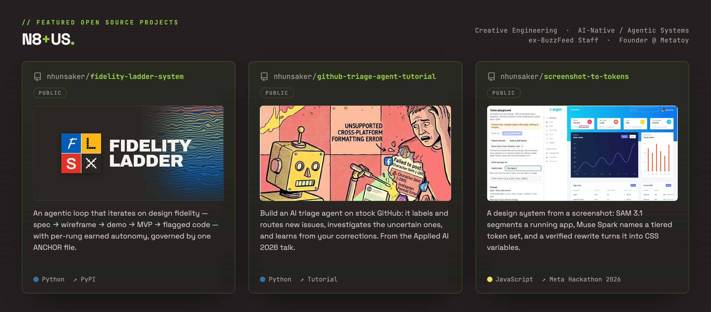

I'm a software engineer and founder who works at the seam where design meets engineering — design systems, front-end craft, and, for the last couple of years, applied AI and agentic systems in production.

**A few things I've built:**

- **[fidelity-ladder-system](https://github.com/nhunsaker/fidelity-ladder-system)**: An agentic loop that iterates on design fidelity rather than code diffs: spec → wireframe → clickable demo → MVP → flagged pull request, with autonomy dialed per rung and a person on every step that cannot be taken back. MIT licensed, `pip install fidelity-ladder`.
- **[github-triage-agent-tutorial](https://github.com/nhunsaker/github-triage-agent-tutorial)**: Build an AI triage agent on stock GitHub. It labels and routes new issues, investigates the uncertain ones, and learns from your corrections. The companion to my Applied AI 2026 talk, "Automate the Queue."
- **[screenshot-to-tokens](https://github.com/nhunsaker/screenshot-to-tokens)**: A design system from a screenshot. SAM 3.1 segments a running app, Muse Spark names a tiered token set, and a verified rewrite turns it into CSS variables with a live Sorb preview. Built for the Meta Global AI Developer Hackathon 2026. Apache-2.0 licensed.

I'm consulting and taking contract work through [N8+US](https://n8plusus.com), and I'm open to the right full-time fit.

📫 **hello@metatoy.com** · [LinkedIn](https://linkedin.com/in/nathanhunsaker) · [metatoy.com](https://metatoy.com) · [portfolio](https://n8plusus.com/portfolio)
