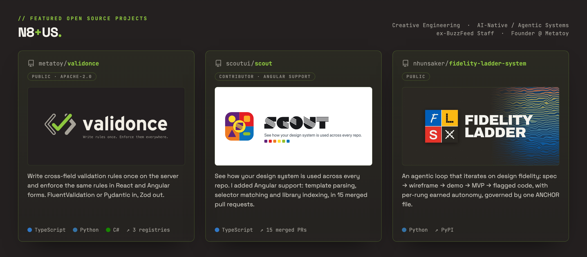

I'm a software engineer and founder who works at the seam where design meets engineering — design systems, front-end craft, and, for the last couple of years, applied AI and agentic systems in production.

**A few things I've built:**

- **[validonce](https://github.com/metatoy/validonce)**: Write cross-field validation rules once on the server and enforce the same rules in the browser. Backends: ASP.NET Core, FastAPI, Fastify, NestJS, Go, Spring Boot, and Kubernetes CRDs (CEL). Frontends: React, Angular, Vue and plain HTML. Published on npm, PyPI, NuGet, Maven Central and the Go module proxy. **[Try it in the playground](https://playground.metatoy.com)**. Comes with an MCP server and a Claude Code plugin that migrate existing validation to validonce and prove nothing changed. Apache-2.0 licensed.
- **[Scout](https://github.com/scoutui/scout)**: An open-source dashboard and CLI that shows how your design system is used across every repo. I added Angular support (template parsing, selector matching and library indexing) in [15 merged pull requests](https://github.com/scoutui/scout/pulls?q=is%3Apr+author%3Anhunsaker+is%3Amerged).
- **[fidelity-ladder-system](https://github.com/nhunsaker/fidelity-ladder-system)**: An agentic loop that iterates on design fidelity rather than code diffs: spec → wireframe → clickable demo → MVP → flagged pull request, with autonomy dialed per rung and a person on every step that cannot be taken back. MIT licensed, `pip install fidelity-ladder`.

I'm consulting and taking contract work through [N8+US](https://n8plusus.com), and I'm open to the right full-time fit.

📫 **hello@metatoy.com** · [LinkedIn](https://linkedin.com/in/nathanhunsaker) · [metatoy.com](https://metatoy.com) · [portfolio](https://n8plusus.com/portfolio)
